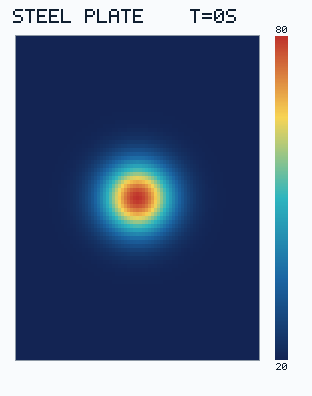

# Bilt + GT4Py integration demo

A small proof of concept combining [Bilt](https://github.com/aviation-impact-accelerator/bilt) with [GT4Py Next](https://github.com/GridTools/gt4py): **Bilt resolves dimensionally checked model relationships; GT4Py executes a numerical stencil.** No changes to Bilt's compiler or a new backend are required.

## Examples

Run with Bilt 0.3.0 and Python 3.15 using [uv](https://docs.astral.sh/uv/):

```sh
uv sync --locked
uv run python diffusion_demo.py
uv run python steel_plate_example.py
```

**1. Five-point Laplacian.** [`diffusion_demo.py`](diffusion_demo.py) computes a periodic Laplacian of a single-cell impulse, using unequal grid spacings (`dx=2 m`, `dy=1 m`), a temperature perturbation measured in kelvin, and reversed tensor axes. The expected central value is −2.5, with contributions of +0.25 along x and +1 along y. This provides a simple, exactly checkable numerical result.


**2. Heat conduction in a steel plate.** [`steel_plate_example.py`](steel_plate_example.py) starts with a localised 80 °C hot spot on a 20 °C plate (81 × 81 cells; `dx=6 mm`, `dy=8 mm`). With a representative steel thermal diffusivity of `1.2 × 10⁻⁵ m²/s`, it evaluates the initial temperature-change rate from the heat equation:

```text
dT/dt = α ∇²T
```

The `HeatPlate` system declares absolute temperature, ambient temperature, length, thermal diffusivity, timestep, temperature rate and updated temperature as dimensioned Bilt ports. A Bilt equation subtracts the ambient reading to produce a relative temperature field (K); its Laplacian has units K/m². Its equations define **dT/dt = α ∇²T** and the **0.5 s forward-Euler step**; GT4Py evaluates the spatial Laplacian. The animation below is generated from **320 successive evaluations of the Bilt–GT4Py model**, from 0 to 160 s, recording a frame every 20 s. Python orchestrates the time loop and renders the output; it does not calculate the heat-equation updates.



The colour scale stays fixed at 20–80 °C. This is a simplified two-dimensional conduction problem with periodic boundaries, no external heat sources and no heat loss. Regenerate the Bilt–GT4Py animation with `uv run python -m scripts.generate_steel_plate_gif` or verify it with `--check`.

## Why this structure?

- **`CartesianGrid2D` subsystem:** Bilt represents grid spacing (length) and derives `1/dx²` and `1/dy²` (inverse area) via ordinary transforms. Those coefficients are physical/discretisation relationships that can be reused independently of GT4Py.
- **`Laplacian2D` subsystem:** Bilt connects the field and grid spacing to the Cartesian grid and computes the requested Laplacian.
- **`HeatPlate` system:** Exposes absolute and relative temperature, `laplacian`, `thermal_diffusivity`, `time_step`, `temperature_rate` and `next_temperature` as dimensioned ports. The heat equation and Euler update are ordinary Bilt equations, not post-processing.
- **GT4Py field operator:** `five_point_laplacian` expresses the stencil using named GT4Py dimensions and shifts, leaving numerical execution to GT4Py.
- **Adapter:** [`gt4py_adapter.py`](gt4py_adapter.py) maps Bilt's named tensor axes onto GT4Py fields, adds a temporary one-cell periodic halo, evaluates the operator and restores the original axis order. Halo storage is an execution detail, not model state.

**Connecting systems through ports.** The parent `HeatPlate` exposes its own `temperature_difference`, `dx`, `dy` and `laplacian` ports. Small connection equations equate them with the corresponding ports on the nested `Laplacian2D` interface. The parameter `stencil: Laplacian2D` in these *connection* equations is a reference to that child interface, not a runtime object passed to a numerical routine. The parent also defines `temperature_difference = temperature - ambient_temperature`, so the stencil acts on temperature differences rather than absolute Celsius readings. The physical relationships use only the parent boundary:

```text
temperature_rate = thermal_diffusivity * laplacian
next_temperature = temperature + time_step * temperature_rate
```

This keeps the heat equation independent of the subsystem that computes the spatial operator. Bilt can analyse the combined relationships and select a calculation route.

## Lessons learned

1. **Map canonical domains to external indexing.** Bilt's canonical tensor-axis order is not necessarily GT4Py's `(I, J)` order. An adapter must map named dimensions to the external kernel's indexing and restore the result order. This demo reads the order from **Bilt's private evaluation context**; a public interface exposing domain metadata would be preferable.
2. **Make repeated time stepping efficient.** Python currently orchestrates 320 Bilt model evaluations, each computing an Euler step with a GT4Py Laplacian. This demonstrates correctness, but repeatedly crosses the Bilt–GT4Py boundary and creates tensors, halo arrays and output buffers. A scalable integration should resolve the model once, reuse compiled kernels and buffers across steps, and keep time-loop orchestration separate from the model equations.

This remains a two-dimensional CPU proof of concept, not a general GT4Py backend or a built-in Bilt time integrator.

## Validation

Tests compare the GT4Py-computed field against an **independent NumPy finite-difference implementation** over the full grid, including reversed axes, periodic boundaries, uniform and seeded random fields, and the steel-plate initial rate. Tests also check conversion from centimetres/millimetres to metres and the output's physical units. GitHub Actions runs pytest, `bilt check`, Ruff, Pyrefly, ty and prek on macOS and Ubuntu. The system ports use Bilt 0.3.0's `QuantityTensor` annotations for unit-bearing array values, while scalar parameters use `Quantity`.

```sh
uv run pytest -q
uv run bilt check .
uv run ruff check .
uv run ruff format --check .
uv run pyrefly check
uv run ty check
uv run prek run --all-files
```

Dependencies use Bilt `main` (currently Bilt 0.3.0) and the [Python 3.15 GT4Py fork](https://github.com/j-emberton/gt4py), recorded in `uv.lock`. Run `uv lock --upgrade-package bilt` to refresh the Bilt revision.
