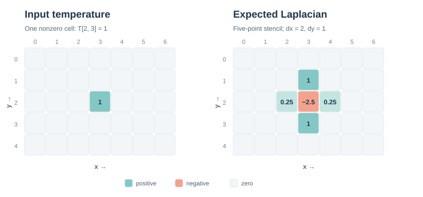
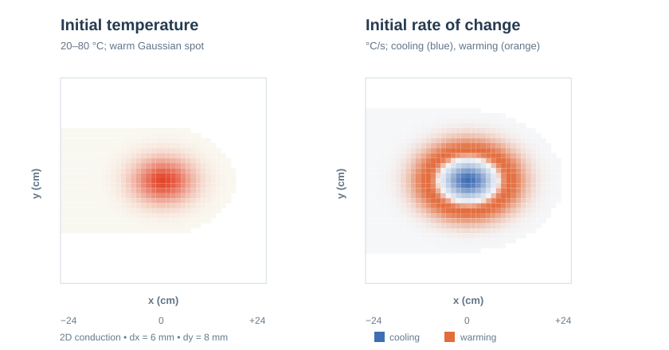

# Bilt + GT4Py: a small stencil integration demo

This example explores how [Bilt](https://github.com/aviation-impact-accelerator/bilt) and [GT4Py Next](https://github.com/GridTools/gt4py) might work together without either library having to take over the other's job.

**Bilt describes the mathematical model:** its inputs, relationships, subsystems and the quantities that need to be calculated. **GT4Py evaluates the stencil:** the numerical operation on a two-dimensional field. The connection is an ordinary Bilt transform that calls a small Python adapter. No changes to Bilt's compiler are needed.

This is deliberately a proof of concept, rather than a new Bilt backend or a reusable GT4Py integration package.

## Try it

You need Python 3.15, [uv](https://docs.astral.sh/uv/) and a C++ toolchain for GT4Py's compiled CPU backend.

```sh
uv sync --locked
uv run python diffusion_demo.py
```

The script checks the calculated values against known results and prints:

```text
Bilt + GT4Py: periodic Laplacian verified
```

## What does the example calculate?

We start with a **5-row by 7-column temperature field**, initially zero except for a single cell with value 1. We calculate its *discrete Laplacian*, a measure of how a cell differs from its neighbours. This is a building block for models of heat diffusion, but **the demo does not advance temperature through time**.

For a uniform Cartesian grid, the five-point stencil is

```text
L(x, y) = [T(x-1, y) - 2 T(x, y) + T(x+1, y)] / dx²
        + [T(x, y-1) - 2 T(x, y) + T(x, y+1)] / dy²
```

We deliberately use different grid spacings, **dx = 2** and **dy = 1**. A unit impulse therefore gives a central value of **−2.5**, two horizontal neighbours of **+0.25**, and two vertical neighbours of **+1**. Everything else is zero.



*Expected numerical output for the demo's input. The script asserts these values against the Bilt/GT4Py calculation; the figure illustrates that known result rather than a separately executed benchmark.*

The spacing matters: the contributions along x are divided by 4, while those along y are divided by 1. The tests also put the nonzero cell at a corner to check the **periodic boundary condition**: neighbours beyond one edge wrap around to the opposite edge.

## A physical example: heat spreading through a steel plate

The impulse test is deliberately simple, but what happens when *every cell* has a temperature? [`steel_plate_example.py`](steel_plate_example.py) uses a smooth, localised warm spot in an otherwise cool, thin steel plate.

The assumptions are modest: two-dimensional conduction, a uniform material, no heat loss to the surroundings during this initial instant, and a representative steel thermal diffusivity of **1.2 × 10⁻⁵ m²/s** (actual values vary with grade and temperature).

- The plate starts near **20 °C**, with a Gaussian warm spot reaching **80 °C** in the centre.
- The computational grid has **81 × 81 cells**, with **6 mm spacing in x** and **8 mm in y**. These unequal physical spacings also exercise the axis-dependent stencil coefficients.
- Bilt supplies the temperature and grid spacing, and resolves the grid subsystem's inverse-squared spacings. GT4Py evaluates the **Laplacian at every cell**.
- The script converts that Laplacian into an *initial rate of temperature change*: **dT/dt = α ∇²T**, where α is the thermal diffusivity. A small **0.5 s forward-Euler step** then gives an illustrative updated temperature. This step is below the explicit stability limit for this grid and diffusivity; it is **one step, not a simulated time history**.



*Expected temperature distribution (left) and initial rate of change in °C/s (right), calculated using an independent finite-difference reference. The centre cools while the surrounding region warms. The automated test checks the complete GT4Py-computed field against this reference.*

Because the warm spot lies well away from the edges, the existing periodic halo is a convenient numerical approximation for this short-time experiment. A real finite plate would need appropriate physical boundary conditions; they are not being modelled here.

Run the example with:

```sh
uv run python steel_plate_example.py
```

This prints the central temperature, its initial cooling rate and its temperature after the short step. Unlike the impulse test, the result varies across many cells and is compared with an independent NumPy reference **over the whole grid**, not just at selected locations.

## Why model the grid as a subsystem?

The example defines two Bilt systems in [`diffusion_demo.py`](diffusion_demo.py):

- **`CartesianGrid2D`** owns grid spacing (`dx`, `dy`) and the derived coefficients (`inv_dx2`, `inv_dy2`). Its two ordinary `@transform` functions calculate `1 / dx**2` and `1 / dy**2`. These are mathematical relationships that could be reused by other grid-based models, not GT4Py-specific code.
- **`Diffusion`** owns the temperature input, grid spacing inputs and requested Laplacian output. Its `@equation` functions connect the parent values to the grid subsystem, and connect the grid's derived coefficients to the Laplacian calculation.

The implementation explicitly assembles the child with

```text
internal_implementations={"grid": grid_implementation}
```

So the grid is a genuine Bilt subsystem, rather than an unrelated Python object passed into a function. This matters for the experiment: Bilt can establish which quantities depend on which other quantities, while the numerical kernel stays separate. The design also leaves room for several components to share a grid definition in a larger model.

The grid does **not** store ghost cells, halos or array-layout details. Those depend on how a numerical backend executes the calculation, rather than on the physical model itself.

## Why the helper functions?

There are three distinct responsibilities in the code:

| Part | Responsibility | Why it lives there |
| --- | --- | --- |
| Bilt `@transform` functions | Calculate the grid coefficients and connect the model to the numerical evaluation | These are part of the model's mathematical dependency structure |
| GT4Py `five_point_laplacian` field operator | Describe the five-point stencil using GT4Py's `Field` and dimension-shift syntax | GT4Py can lower this operation to a numerical backend |
| Python `periodic_laplacian` helper in [`gt4py_adapter.py`](gt4py_adapter.py) | Translate between Bilt tensors and GT4Py fields, add a temporary periodic halo, call the field operator and convert the result back | Array layout and boundary storage are execution details, not Bilt equations |

### The data flow

```text
Bilt Diffusion model
  temperature: Tensor over (y, x)      dx, dy
              |                          |
              |                 CartesianGrid2D subsystem
              |                     inv_dx2, inv_dy2
              +------------+-------------+
                           |
                    Bilt laplacian transform
                           |
                    periodic_laplacian helper
                      1. reorder axes
                      2. add periodic halo
                      3. run GT4Py field operator
                      4. remove halo, restore axes
                           |
                  Bilt laplacian: Tensor over (y, x)
```

The **axis mapping is intentional**. The model supplies a Bilt tensor ordered `(y, x)`, while GT4Py uses its own ordered dimensions `(I, J)`. The helper uses Bilt's named dimensions to transpose the values correctly before calling GT4Py, then restores the original order. The caller never needs to work with a GT4Py `Field`.

The helper also pads the input with a **one-cell periodic halo**. This lets the stencil read neighbours at the boundaries; the padded cells are removed from the output and never become part of the Bilt tensor's domain.

### What is still experimental?

The adapter currently reads **Bilt's private evaluation context** to recover the aligned tensor's dimension order inside a compiled transform. That is a pragmatic bridge for a demo, not a public or stable API. A production integration would need an explicit, supported way to pass axis/domain metadata to a numerical implementation.

The example is also intentionally narrow: two spatial dimensions, periodic boundaries and one GT4Py CPU stencil. It does not cover staggered grids, unstructured meshes, batch dimensions, unit conversions, time integration, JAX differentiation or a general GT4Py backend.

## Tests and development checks

[`tests/test_diffusion_demo.py`](tests/test_diffusion_demo.py) compares the result with an **independent NumPy implementation**, not with another invocation of the GT4Py stencil. The cases cover unequal grid spacing, both Bilt axis orders and periodic wrapping at a corner. A second test checks the steel-plate example against an independent NumPy Laplacian at **all 6,561 cells**, including the rate of change and conservation of the average temperature over the Euler step. A separate test checks the grid's derived coefficients through Bilt's public API.

```sh
uv run pytest -q
uv run ruff check .
uv run ruff format --check .
uv run pyrefly check
uv run ty check
uv run prek run --all-files
```

[GitHub Actions](.github/workflows/check.yml) runs these checks and the example on **Ubuntu and macOS**, with Python 3.15. As in Bilt, the repository uses uv, Ruff, Pyrefly, ty and prek; GT4Py's non-standard field annotations require a few targeted checker suppressions.

## Dependencies

The project uses Bilt's `main` branch and the [Python 3.15 GT4Py fork](https://github.com/j-emberton/gt4py) through Git dependencies in `pyproject.toml`. The committed `uv.lock` records the resolved revisions. To pick up later changes from those branches, deliberately update the lockfile and rerun the checks.

The immediate question is whether **Bilt's existing structural model can use GT4Py as a numerical implementation detail**. This example shows what that boundary could look like without adding GT4Py-specific concepts to Bilt core.
